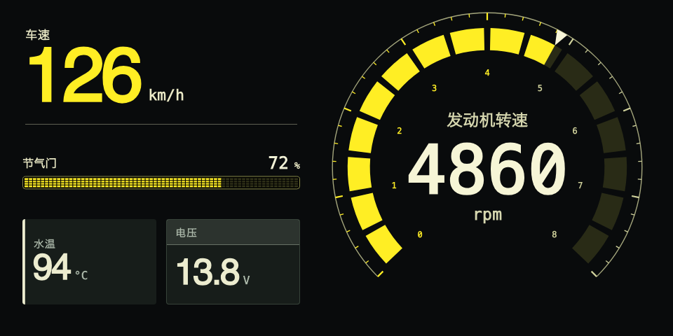

# EasyDash 仪表主题生成 Skill

在 Codex 中描述想要的车载仪表，生成可在 EasyDash Studio 编辑、在手机 EasyDash 中导入的 `.easydash.json` 文件。也可以提供参考图，或附上旧主题，只改变外观并保留原有数据绑定。



## 快速开始

1. [下载 Skill ZIP](downloads/easydash-theme.zip?raw=true)，解压后将整个 `easydash-theme` 文件夹放进工作项目的 `.agents/skills/`。目录中应有 `.agents/skills/easydash-theme/SKILL.md`。
2. 在 Codex 中打开这个工作项目，新建对话，发送下方提示词。图像与声音打包工具使用 Python 3 标准库。
3. 在 EasyDash Studio 点「打开工程」，选择生成的 `.easydash.json`，播放模拟数据预览。手机端从「主题中心 → 导入主题」选择同一文件。

```text
$easydash-theme 帮我生成一套黑黄横屏仪表。左侧用大数字显示车速，右侧用分块环显示转速，下方放水温和保留一位小数的电压铭牌卡。每个数据位都能在手机上重新绑定。请交付可编辑的 .easydash.json。
```

## 下载与参考

- [可直接导入的示例主题《黄线俱乐部》](examples/yellowline-club.easydash.json?raw=true)
- [七组中文提示词与使用说明](skills/easydash-theme/使用与提示词.md) · [下载纯文本提示词](downloads/用户生成提示词.txt?raw=true)
- [下载 .skill 格式](downloads/easydash-theme.skill?raw=true)
- [Skill 源码](skills/easydash-theme/SKILL.md) · [主题格式、数据通道与音效规范](skills/easydash-theme/references/theme-format.md)
