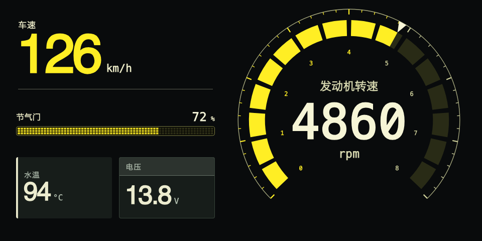

# EasyDash 主题生成提示词

## 第一次使用

1. 解压分发的 ZIP，在 Codex 中打开一个工作文件夹。把整个 `easydash-theme` 目录放进这个工作文件夹的 `.agents/skills/` 下，最终应能找到 `.agents/skills/easydash-theme/SKILL.md`。打开该工作文件夹的新对话。
2. 复制下方一段提示词发送。可以一起附上参考图、已有的 `.easydash.json` 或自己的素材。生成的文件保存在当前工作目录。附带的打包工具使用 Python 3 标准库。
3. 电脑上用 EasyDash Studio 的「打开工程」选生成的 `.easydash.json`，点「播放模拟数据」预览；手机上在 EasyDash「主题中心 → 导入主题」选同一文件。要先体验一个成品，也可以在 Studio 中直接打开技能包里的 `assets/starter.json`。



## 直接生成一套黑黄赛道仪表

```text
$easydash-theme 帮我做一套横屏 1280×520 的黑黄赛道仪表，可以直接导入 EasyDash。左上是大字车速，单位 km/h；右侧用粗分块环显示发动机转速，量程 0–8000 rpm；左下用点阵条显示水温和机油温度，再用带小单位的铭牌卡显示电压，保留一位小数。底图固定，只有读数和进度随车变化。每项都能在手机上换绑原车通道。请生成可编辑的 .easydash.json，并告诉我怎样预览。
```

## 我有一张参考图

```text
$easydash-theme 根据我附的参考图，做一套能导入的仪表主题。我最喜欢它的外圈细刻度、中央大数字和左侧紧凑的数据列。保留这种主次关系，用原生组件重新画。车速、转速、水温和电压都用车辆数据驱动；将同一转速的数字和弧线绑到同一个槽位。适配横屏，给我工程文件和通道清单。
```

## 我只想给已有数值卡换皮肤

```text
$easydash-theme 修改我附的旧主题。把车速换成计时大字，发动机转速换成扫描线数字，水温换成侧标卡，电压换成铭牌卡。保留原有布局、颜色、单位、小数位、报警阈值、作品 ID 和槽位，以及已有图片和音效。输出一个新版文件，让装过旧版的用户沿用自己的车辆绑定。
```

## 我想要竖屏和大字

```text
$easydash-theme 做一套手机竖屏夜间仪表，画布 390×760。车速用最大的数字放在上半屏，中间用连续条显示转速，底部并排放水温和电压。用炭黑底、暖白数字和琥珀色强调，单位贴近读数。主题离线可用，给我能直接导入的文件。
```

## 我有角色图片，想让它跟转速变化

```text
$easydash-theme 用我上传的三张原创角色图做一个固定镜头的仪表。转速低于 2200 rpm 时用第一张，达到 2200 rpm 用第二张，达到 5000 rpm 用第三张，降速时跟着切回。把车速和转速放在角色左侧，保证读数清晰。把三张图嵌入主题包，导出 .easydash.json。
```

## 我有自己的换挡提示音

```text
$easydash-theme 给我附的仪表加上我上传的短 WAV。发动机转速上穿 5000 rpm 时播放一次，回落到 4500 rpm 以下后才允许再次触发，两次提示至少间隔 3 秒。原来的通道、画面和配色保持原设置。打包时把提示音一起嵌入，并告诉我怎样在编辑器里试听。
```

## 自己填需求

```text
$easydash-theme 为我生成可导入的 EasyDash 仪表主题。
屏幕方向和尺寸：【横屏或竖屏，可填分辨率】
视觉参考：【附图或描述风格、底色、强调色】
第一眼要看清：【最重要的通道、单位】
其他数据：【通道、呈现方式、小数位】
联动效果：【哪个读数变化时，哪个局部跟着变】
已有素材或旧主题：【按需附文件】
请交付 .easydash.json、导入方式，以及能在手机上重新绑定的通道清单。
```
